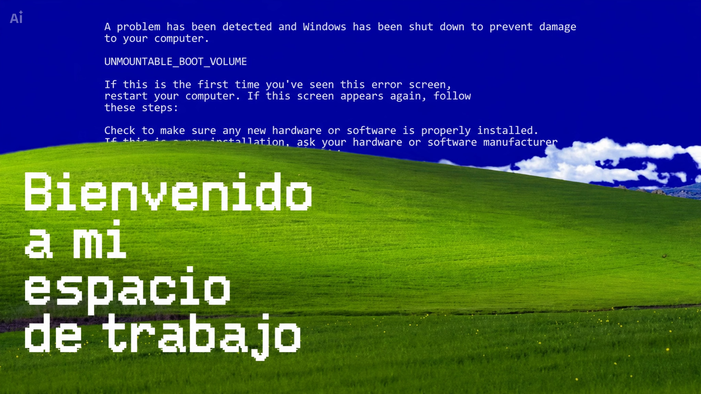
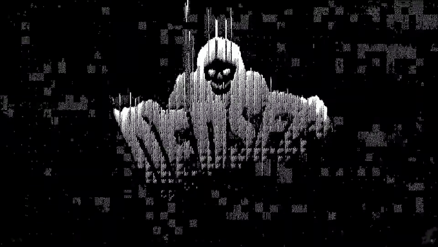

  

<h1 align="center">¡HOLA! Soy Luizabeth 👋🇻🇪</h1>

  Tengo 15 años y soy de Venezuela. Tengo un sueño muy claro: <b>crear y consolidar la empresa tech número 1 de Venezuela creada por una chica liceísta</b>. Estoy trabajando duro a diario y aquí en mi GitHub puedes ver un poco de mi trabajo.

  Actualmente trabajo como <b>freelancer</b> y soy líder y única desarrolladora de mi propio estudio de tecnología en crecimiento: <b>luizabeth's .studios</b>. 
  👉 <a href="https://clientes-chi.vercel.app" target="_blank">Conoce más de mi trabajo y visita mi web de clientes aquí</a>

---

## 🎯 ¿A qué me dedico?
- 📚 **Estudiar:** Actualmente estoy aprendiendo constantemente sobre tecnologías y temas nuevos a diario de forma autodidacta y en la secundaria.
- 💡 **Crear:** Tanto proyectos de programación como manualidades y diseños en Figma; me encuentro constantemente descubriendo mi creatividad.
- 🔭 **Aprender y explorar:** Investigar sobre nuevos campos nunca está de más; actualmente investigo mucho sobre ingeniería nuclear, el reino fungi y cómo funciona realmente el fanatismo.

---

## 🌍 Cambiar Idioma / Change Language (Haz clic para desplegar)

  
<b>🇬🇧 English (Inglés)</b>

   
  <h3>HELLO! I'm Luizabeth 👋🇻🇪</h3>
  

    I'm 15 years old and from Venezuela. I have a very clear dream: <b>to create and consolidate the #1 tech company in Venezuela founded by a high school girl</b>. I work hard every day, and here on my GitHub you can see a bit of my work.
  

  

    I currently work as a <b>freelancer</b> and I am the leader and sole developer of my own growing tech studio: <b>luizabeth's .studios</b>. 
    👉 <a href="https://clientes-chi.vercel.app" target="_blank">Learn more about my work and visit my client website here</a>
  

  <h4>🎯 What do I dedicate myself to?</h4>
  <ul>
    <li>📚 <b>Studying:</b> I am constantly learning about new technologies and topics every day, both self-taught and in high school.</li>
    <li>💡 <b>Creating:</b> Both programming projects, crafts, and Figma designs; I am constantly discovering my creativity.</li>
    <li>🔭 <b>Learning & Exploring:</b> Researching new fields never hurts; I am currently deeply researching nuclear engineering, the fungi kingdom, and how fanaticism really works.</li>
  </ul>

  
<b>🇮🇹 Italiano (Italiano)</b>

   
  <h3>CIAO! Sono Luizabeth 👋🇻🇪</h3>
  

    Ho 15 anni e vengo dal Venezuela. Ho un sogno molto chiaro: <b>creare e consolidare l'azienda tech numero 1 del Venezuela fondata da una studentessa liceale</b>. Lavoro sodo ogni giorno e qui sul mio GitHub puoi vedere un po' del mio lavoro.
  

  

    Attualmente lavoro come <b>freelancer</b> e sono leader e unica sviluppatrice del mio studio tecnologico in crescita: <b>luizabeth's .studios</b>. 
    👉 <a href="https://clientes-chi.vercel.app" target="_blank">Scopri di più sul mio lavoro e visita il mio sito clienti qui</a>
  

  <h4>🎯 A cosa mi dedico?</h4>
  <ul>
    <li>📚 <b>Studiare:</b> Attualmente imparo costantemente nuove tecnologie e argomenti ogni giorno da autodidatta e al liceo.</li>
    <li>💡 <b>Creare:</b> Sia progetti di programmazione che lavori manuali e design su Figma; scopro costantemente la mia creatività.</li>
    <li>🔭 <b>Imparare ed esplorare:</b> Ricercare nuovi campi non guasta mai; attualmente studio molto l'ingegneria nucleare, il regno dei funghi e come funziona davvero il fanatismo.</li>
  </ul>

  
<b>🇩🇪 Deutsch (Alemán)</b>

   
  <h3>HALLO! Ich bin Luizabeth 👋🇻🇪</h3>
  

    Ich bin 15 Jahre alt und komme aus Venezuela. Ich habe einen sehr klaren Traum: <b>das Tech-Unternehmen Nummer 1 in Venezuela aufzubauen und zu etablieren, gegründet von einer Gymnasiastin</b>. Ich arbeite jeden Tag hart dafür und hier auf meinem GitHub kannst du einen Teil meiner Arbeit sehen.
  

  

    Derzeit arbeite ich als <b>Freelancerin</b> und bin Leiterin sowie einzige Entwicklerin meines eigenen wachsenden Technologie-Studios: <b>luizabeth's .studios</b>. 
    👉 <a href="https://clientes-chi.vercel.app" target="_blank">Erfahre mehr über meine Arbeit und besuche hier meine Kunden-Website</a>
  

  <h4>🎯 Womit beschäftige ich mich?</h4>
  <ul>
    <li>📚 <b>Lernen:</b> Ich lerne derzeit täglich autodidaktisch und in der Schule ständig neue Technologien und Themen.</li>
    <li>💡 <b>Erschaffen:</b> Sowohl Programmierprojekte als auch Bastelarbeiten und Designs in Figma; ich entdecke ständig meine Kreativität neu.</li>
    <li>🔭 <b>Forschen & Entdecken:</b> Neue Gebiete zu erforschen schadet nie; derzeit beschäftige ich mich intensiv mit Kerntechnik, dem Reich der Pilze und wie Fanatismus wirklich funktioniert.</li>
  </ul>

  
<b>🇷🇺 Русский (Ruso)</b>

   
  <h3>ПРИВЕТ! Я Луизабет 👋🇻🇪</h3>
  

    Мне 15 лет, и я из Венесуэлы. У меня есть четкая мечта: <b>создать и укрепить технологическую компанию №1 в Венесуэле, основанную школьницей</b>. Я усердно работаю каждый день, и здесь, на моем GitHub, вы можете увидеть часть моих работ.
  

  

    Сейчас я работаю как <b>фрилансер</b>, а также являюсь лидером и единственным разработчиком своей растущей технологической студии: <b>luizabeth's .studios</b>. 
    👉 <a href="https://clientes-chi.vercel.app" target="_blank">Узнайте больше о моей работе и посетите мой сайт для клиентов здесь</a>
  

  <h4>🎯 Чем я занимаюсь?</h4>
  <ul>
    <li>📚 <b>Учеба:</b> Я постоянно изучаю новые технологии и темы каждый день самостоятельно и в старшей школе.</li>
    <li>💡 <b>Творчество:</b> Как проекты по программированию, так и поделки и дизайн в Figma; я постоянно открываю в себе креативность.</li>
    <li>🔭 <b>Изучение и исследование:</b> Исследовать новые области никогда не лишнее; сейчас я активно изучаю ядерную инженерию, царство грибов и то, как на самом деле работает фанатизм.</li>
  </ul>

  
<b>🐉 Valyrio Udrir (Alto Valyrio)</b>

   
  <h3>RYTSAS! Nyke Luizabeth iksan 👋🇻🇪</h3>
  

    Ampa-kēli jēdar issi se Venezuela iksan. Ēdruta sȳz emagon: <b>Venezuela hen tech dāria mērī glaeson se dārilaros riña iksos</b>. Tubī tubī kessa gūrogon, se kesīr ñuha GitHub hen ñuha vāedar urnēbagon kostā.
  

  

    Sir <b>freelancer</b> iksan se ñuha tech dāria mērī dārilaros se vāedaros iksan: <b>luizabeth's .studios</b>. 
    👉 <a href="https://clientes-chi.vercel.app" target="_blank">Ñuha vāedar urnēbās se ñuha web kesīr rhaeshis</a>
  

  <h4>🎯 Skoriot gūrogon?</h4>
  <ul>
    <li>📚 <b>Gūrogon (Estudiar):</b> Tubī tubī sīr technologies se sīr aōt gūrogon ñuha dārilaros se school.</li>
    <li>💡 <b>Pāragon (Crear):</b> Code vāedar, crafts se Figma designs pāragon; ñuha creativity urnēbagon.</li>
    <li>🔭 <b>Urnēbagon se Rhaeshis (Aprender y explorar):</b> Sīr fields rhaeshis sȳz issi; sir nuclear engineering, fungi kingdom se fanaticism skoriot gūrogon rhaeshis.</li>
  </ul>

---

## 🚀 Lo que hago
- 💻 **Crear apps web**
- 🎮 **Creación de juegos**
- 🎬 **Edición de video**
- 🛠️ **Resolver problemas**
- 🔒 **Ciberseguridad y Hacking ético sencillo**

---

## 🌐 Conéctate conmigo

  
  
  
  
  

---

## 💎 Tecnologías y Herramientas

  

---

## 📊 GitHub Analytics

  
  

  

---

  

> *"Mis caídas son muchas, pero mi ambición es más grande."*  
> *"Mis cicatrices son varias, pero mi voluntad es una: vencer."*  
> *"Mis dudas son pasajeras; mis metas, innegociables."*  
> *"Mis errores me enseñan, pero mis sueños me gobiernan."*  
> *"El camino es largo, pero mi hambre de éxito es infinita."*  
> *"Mis miedos hacen ruido, pero mis hechos hablan más fuerte."*

