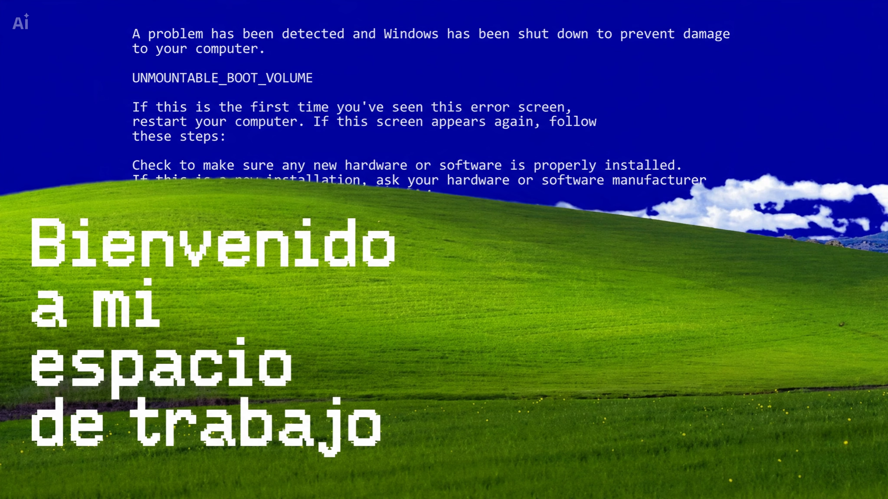

  

<h1 align="center">¡Hola, soy Luizabteh! 👋🇻🇪</h1>

  Tengo 15 años y soy de Venezuela. Tengo un sueño muy claro: <b>crear y consolidar la empresa tech número 1 de Venezuela</b>. Trabajo duro día a día para hacerlo realidad.

  Actualmente trabajo como <b>freelancer</b> y lidero mi propio estudio tecnológico en crecimiento: <b>Luizabeth's Studios</b>. 
  👉 <a href="https://clientes-chi.vercel.app" target="_blank">Conoce mi web de clientes aquí</a>

---

## 🎯 ¿A qué me dedico?
* 📚 **Estudiar**
* 💡 **Crear**
* 🔭 **Aprender y explorar**

---

## 🚀 Lo que hago
* 💻 **Crear apps web**
* 🎮 **Creación de juegos**
* 🎬 **Edición de video**
* 🛠️ **Resolver problemas**
* 🔒 **Ciberseguridad y Hacking ético sencillo**

---

## 🌐 Conéctate conmigo

  
  
  
  
  

---

## 💎 Tecnologías y Herramientas

  

---

## 📊 GitHub Analytics

  
  

  

